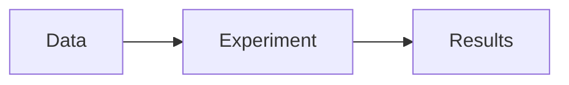

# relcon-docs

Shared documentation defaults, styling, and configuration tools for Relaxed Constraints
projects using Zensical.

Install this package as a **documentation dependency**. It supplies Zensical, the
Python API handler and formatter, shared modern-theme settings, and copy-button CSS.
It has no dependency on BONDI or Yanex.

## Configure a project

Once installed in your project's environment:

```sh
relcon-docs configure --dry-run
relcon-docs configure
zensical serve
```

The project directory must already exist. A fresh project gets a minimal
`mkdocs.yml`; add your Markdown pages under `docs/` and edit navigation as needed.
The starter uses a localhost `site_url` for previews. Replace it with the published
site URL before deployment; Markdown exports require this setting.
For an existing YAML project, add `INHERIT: .relcon-docs/base.yml` first.
Convert and remove any `zensical.toml` before configuring: Zensical prefers it over YAML.

| File | Owner |
| --- | --- |
| `.github/workflows/docs.yml` | Project: deployment triggers and reusable workflow revision |
| `mkdocs.yml` | Project: metadata, navigation, API paths, Markdown-export sections and overrides |
| `.relcon-docs/base.yml` | Package: theme, Markdown extensions and API-rendering defaults |
| `docs/stylesheets/relcon-docs.css` | Package: labeled copy-button styling |
| `.relcon-docs/state.json` | Tool: applied version and hashes for detecting manual edits |

Commit these files. Configuration is explicit: installing or upgrading the
dependency never rewrites project files. Builds and previews use ordinary
`zensical` commands, without a wrapper or sibling checkout.

## Upgrade and review

Upgrade the dependency and lockfile, then run:

```sh
relcon-docs configure --dry-run
relcon-docs configure
zensical build --strict
```

Unmodified managed files are updated. A changed or deleted managed file produces a
conflict and **no files are written**. On first adoption, an existing managed path
with different contents also conflicts. Identical contents can be adopted safely.

Move customizations into project overrides or a separate stylesheet. To explicitly
replace conflicting managed files, use `configure --force`; inspect the proposed
changes first with `configure --dry-run --force`. Force never rewrites an existing
`mkdocs.yml` or `.github/workflows/docs.yml`. Invalid state files must be restored from Git; force does not bypass
state validation or symlink protection.

Each file replacement is atomic; the full set is not a filesystem transaction.
State is written last, and an interrupted run can be retried.

## Project overrides

Mappings merge recursively. Lists replace inherited lists, so repeat the shared
entries when overriding `theme.features` or `extra_css`. Use mapping syntax for
plugins and Markdown extensions to preserve unrelated inherited defaults:

```yaml
INHERIT: .relcon-docs/base.yml
site_name: My research project
site_url: https://example.org/my-project/
plugins:
  mkdocstrings:
    handlers:
      python:
        paths: [src]
  llmstxt:
    sections:
      Documentation: ["*.md"]
      API reference: ["reference/**/*.md"]
```

Markdown exports and `llms.txt` are enabled in the shared defaults for all
Markdown pages, including nested pages. Existing projects inherit them without
adding a local plugin configuration. A valid project `site_url` is required.

The shared index uses a `Documentation` section. Section mappings merge during
inheritance: override `Documentation` to change its page patterns; adding a
different section name retains the inherited section too. Most projects can omit
`llmstxt` entirely. Set `plugins.llmstxt.enabled: false` to opt out.

This first version supports the standard `docs/` source directory and direct
inheritance from `.relcon-docs/base.yml`. It does not migrate arbitrary configurations,
prune old stylesheets, or modify existing workflow files.

## Callouts, collapsible notes and diagrams

Shared defaults enable `admonition`, `pymdownx.details` and Mermaid fenced
blocks. Projects do not need local extension configuration for these features.
For example:

````markdown
!!! note "Research note"

    Record assumptions beside your results.

??? tip "Show details"

    Put optional explanations here.


````

Zensical initializes Mermaid on pages containing diagrams. Project-specific
diagram colors and styles can remain in a separate local stylesheet.
If overriding `custom_fences`, include the Mermaid entry too: lists replace
inherited lists.

## GitHub Pages deployment

`configure` creates `.github/workflows/docs.yml` **only when absent**. The starter
enables manual deployment (`workflow_dispatch`) and includes commented examples
for pushes to `main` and published releases. After creation the file belongs to the
project: rerunning configure, including with `--force`, leaves it byte-for-byte
unchanged. It is not included in the managed-file hashes. A missing starter is
reported by `--check` and shown by `--dry-run`; ordinary configure recreates it.

The starter calls the shared
[`deploy-docs.yml`](https://github.com/relaxed-constraints/relcon-docs/blob/main/.github/workflows/deploy-docs.yml)
workflow. It checks out the **caller repository and triggering revision**, installs
its locked `docs` dependency group, checks managed configuration, runs a strict
Zensical build, uploads `site/`, and deploys it to GitHub Pages. It does not update
configuration during deployment.

Choose the project's policy by editing the starter's `on` mapping. For BONDI,
keep automatic deployment limited to published releases:

```yaml
on:
  workflow_dispatch:
  release:
    types: [published]
```

A consumer project can instead publish on each push to `main`:

```yaml
on:
  workflow_dispatch:
  push:
    branches: [main]
```

The caller grants `contents: read`, `pages: write` and `id-token: write`.
The build job uses read-only repository access; the deployment job gets Pages
permissions and uses the `github-pages` environment. Deployments share a concurrency
group and do not cancel an in-progress deployment.

### Repository setup and workflow updates

- Set **Settings → Pages → Source → GitHub Actions** once in each repository.
- Set the project's `site_url` to its published URL before deploying.
- Commit `uv.lock`, provide a `docs` dependency group, and use the standard
  `docs/` source and `site/` output directories.
- For release deployment, allow the release tags under the `github-pages`
  environment's deployment protection rules.
- When an existing deployment workflow uses another name (such as `pages.yml`),
  consolidate it with the starter before enabling automatic triggers. Configure
  does not remove or alter other workflows.

The starter references `@main`; use a reviewed full commit SHA for reproducible
deployment tooling. No `v1` tag is assumed. The workflow revision and Python package
dependency are independent: upgrading the package never rewrites the caller's
workflow reference or triggers.

Optional caller job inputs are `python-version` (default `"3.11"`) and
`uv-version` (default `"0.13.6"`). For example:

```yaml
jobs:
  docs:
    uses: relaxed-constraints/relcon-docs/.github/workflows/deploy-docs.yml@main
    with:
      python-version: "3.12"
```

## CLI reference

`relcon-docs configure [--project PATH] [--dry-run | --check] [--force]`

- `--project`: target an existing project root; defaults to the working directory.
- `--dry-run`: print proposed file diffs without writing. Conflicts still fail unless forced.
- `--check`: write nothing; exit 0 when current, 1 for pending updates, 2 for errors/conflicts.
- `--force`: explicitly replace conflicting managed files; incompatible with `--check`.
- `relcon-docs --version`: display the installed package version.

Use `relcon-docs configure --check` in CI before `zensical build --strict`.

## Development

```sh
uv sync --locked
uv run pytest
uv run ruff check .
uv run ruff format --check .
uv run relcon-docs configure --check
uv run zensical build --strict
uv build
```

For a local consumer trial before publishing, install the built wheel in an isolated
environment. The installed package contains all assets; consumers need no checkout
of this repository.
