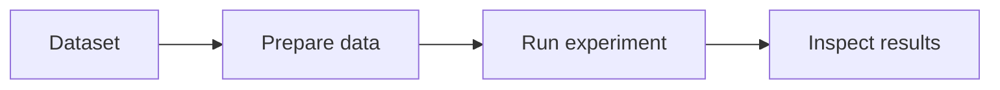
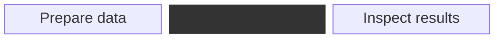
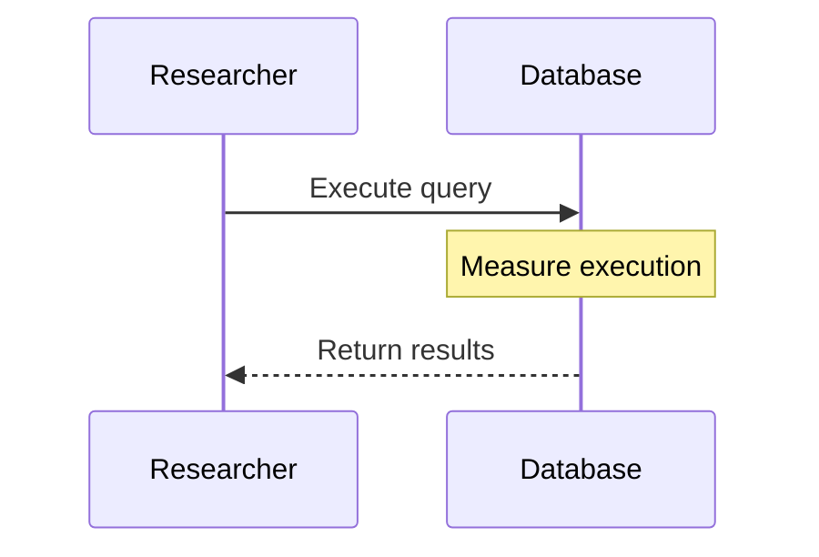

# Diagrams

[Mermaid](https://mermaid.js.org/) turns text descriptions into diagrams in the
browser. relcon-docs enables its fenced-block syntax and supplies light/dark
colours. Put a block like this in any documentation page:

````markdown

````

The code above is displayed as source; the same diagram is rendered below.
Use flowcharts for pipelines, sequence diagrams for interactions, and block
diagrams when precise grouping and explicit colour styling are useful.

The shared palette uses muted blue-grey surfaces, readable labels and distinct
borders. Switch between light and dark mode to review the examples below.
Colour complements labels and shapes; it does not encode a result or status.

## Standard flowchart

No inline styling is needed for ordinary flowchart nodes, labels and connectors.


## Highlight a box

Use the warm amber accent sparingly to draw attention to a particular step.
The label identifies the focus too, so colour is not the only cue. The fill,
border and text colours are paired for contrast in both themes.



Apply these three properties together to the box you want to highlight:

```text
fill:var(--relcon-diagram-accent-bg)
stroke:var(--relcon-diagram-accent-border)
color:var(--relcon-diagram-accent-text)
```

This example uses Mermaid's block-diagram syntax, which accepts CSS variables
in style declarations. Flowchart style declarations currently reject `var(...)`.
The accent means emphasis, not success, failure or warning.

## Sequence diagram

Actors, messages and notes use the same visual roles.



## Custom frame and nodes

For diagram types with explicit style declarations, use the shared CSS properties.
These properties cross Zensical's Mermaid shadow-root boundary and respond to
light/dark theme changes without separate diagram definitions.


The supported properties are `--relcon-diagram-frame-bg`,
`--relcon-diagram-frame-border`, `--relcon-diagram-node-bg`,
`--relcon-diagram-node-border`, `--relcon-diagram-text` and `--relcon-diagram-edge`.
Old `--jb-frame-*`, `--jb-node-*` and `--jb-diagram-text` names remain aliases.

Projects may override these properties in their own stylesheet. No local diagram
stylesheet is necessary to use the shared palette. Explicit hard-coded Mermaid
styles can override the shared defaults. The native mappings cover flowcharts
and the sequence roles shown here; other diagram types may need explicit styles.
