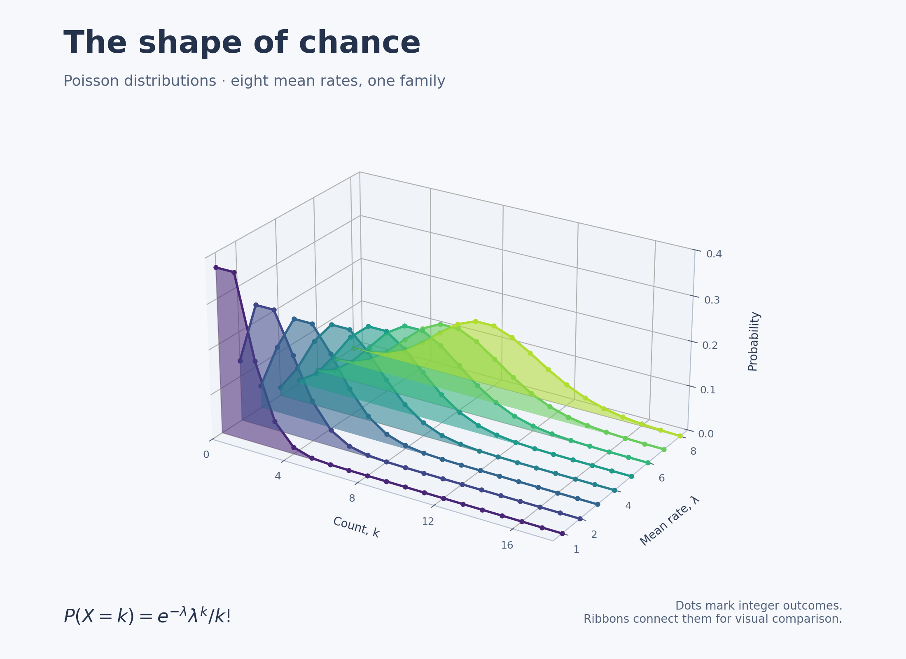

# Images and figures

Use an image file for a photograph, plot, screenshot or exported illustration.
The example below is a Matplotlib plot exported as a PNG. It shows analytical
Poisson distributions, not measured experiment results. Mermaid remains the
preferred tool for workflow and relationship diagrams.

## A basic image

A Markdown image uses an exclamation mark, alternative text and a path:

```markdown

```


Paths are relative to the Markdown page. Describe the image's meaning in the
alternative text so readers can understand it without seeing the image.

## A figure with a caption

Use HTML's `figure` and `figcaption` elements when an image needs a caption.
The shared stylesheet makes figures responsive and separates the caption from
the image. Captions are written explicitly; numbering is not automatic.

```html
<figure>
  
  <figcaption>Figure 1. Poisson distributions for mean rates 1–8. Dots mark integer outcomes; ribbons are visual guides.</figcaption>
</figure>
```

<figure>
  
  <figcaption>Figure 1. Poisson distributions for mean rates 1–8. Dots mark integer outcomes; ribbons are visual guides.</figcaption>
</figure>

Zensical resolves both Markdown images and these HTML image sources relative to
the source page, then rewrites their URLs for the published site.

## Local files and web images

Keep important figures under `docs/images/` so they are versioned and published
with the documentation. PNG and JPEG work well for photographs and screenshots;
SVG stays sharp for plots and illustrations.

A web URL also works:

```markdown

```

That URL is illustrative. A real remote image must remain publicly accessible,
permit embedding, and have suitable usage rights. Its availability depends on
the external host; local images do not have that dependency.

## Enlarge images

Click an image to open the full-screen lightbox with zoom controls. Press Escape
or select the close button to return to the page. Ordinary Markdown images and
images in HTML figures are enabled automatically, including API examples.
Right-click an image and choose **Open image in new tab** to view it alone.

This uses Zensical's built-in GLightbox support; no additional dependency or
image markup is needed. Shared configuration enables `plugins.glightbox`.

## Regenerate the example plot

The example is available as a [PNG](images/poisson-distributions.png) and a
[vector SVG](images/poisson-distributions.svg). From the repository root, run:

```sh
uv run scripts/generate_example_plot.py
```

The script declares its own pinned Matplotlib and NumPy dependencies. They are
used only to regenerate the committed images, not to build the docs or run
relcon-docs. It evaluates the Poisson probability mass function at integer
outcomes for mean rates 1–8. The translucent connecting ribbons are visual guides,
not continuous probability densities.
