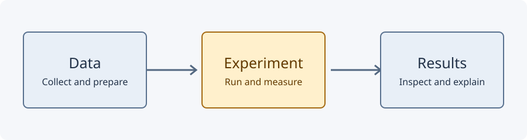

# Layouts and richer Markdown

These examples work in normal documentation and presentation pages. Shared
configuration enables `attr_list`, `md_in_html`, `def_list` and `footnotes`.
No extra CSS or separate grid library is needed.

## Two images side by side

Use separate paragraphs inside a `grid` container. The grid places the images
side by side when space permits and stacks them on narrow screens. Click an
image to enlarge it with the shared lightbox.

<div class="grid" markdown>




</div>

```markdown
<div class="grid" markdown>


</div>
```

Keep the blank lines around the Markdown content and between the images. The
`markdown` attribute tells the renderer to parse Markdown inside the HTML wrapper.

## Card grids

<div class="grid cards" markdown>

-   **Describe the experiment**

    ---

    Record the question, dataset and conditions before collecting measurements.

    [Markdown examples](markdown.md)

-   **Show the evidence**

    ---

    Pair figures with captions that explain the comparison and its limits.

    [Figure examples](figures.md)

</div>

```markdown
<div class="grid cards" markdown>

-   **Describe the experiment**

    ---

    Record the question, dataset and conditions.

-   **Show the evidence**

    ---

    Pair figures with explanatory captions.

</div>
```

## Generic grids and block attributes

A regular grid can mix different kinds of blocks. Here, `{ .card }` attaches a
class to a paragraph while the neighbouring quotation remains unboxed.

<div class="grid" markdown>

**Measurement** — Record timings together with the experimental conditions.
{ .card }

> **Interpretation** — Explain what the measurements support and what remains uncertain.

</div>

```markdown
<div class="grid" markdown>

**Measurement** — Record timings and conditions.
{ .card }

> **Interpretation** — Explain the evidence and limitations.

</div>
```

## Image width and alignment

<div markdown>

{ align=left width="220" }

This image uses `align=left` and a width of 220 pixels. Text flows beside the
image when space permits. Use `align=right` to place it on the other side.
Grids are preferable when both pictures should occupy equal columns; alignment
is useful when prose should wrap around a small illustration.

</div>

<div style="clear: both;"></div>

```markdown
{ align=left width="220" }

Text flows beside the image.
```

The empty clearing element above ends the float before the next example:

```html
<div style="clear: both;"></div>
```

## Captions and lazy loading

<figure markdown="span">

{ width="360" loading=lazy }

<figcaption>A workflow diagram, sized with an attribute list and loaded lazily.</figcaption>
</figure>

```markdown
<figure markdown="span">

{ width="360" loading=lazy }

<figcaption>A short explanation of the figure.</figcaption>
</figure>
```

## Definition lists

Baseline
:   The reference configuration used for comparison.

Candidate
:   A configuration evaluated against the baseline.

Repeat
:   A separate measurement under the same conditions.

```markdown
Baseline
:   The reference configuration used for comparison.

Candidate
:   A configuration evaluated against the baseline.
```

## Footnotes

Keep qualifications close to a claim without interrupting the main paragraph.
For example, report the median execution time across repeated measurements.[^timing]

[^timing]: Specify whether warm-up runs were excluded, and report the number of
    repetitions. This is an authoring example, not a reported experiment.

```markdown
Report the median execution time.[^timing]

[^timing]: Explain how the measurements were collected.
```

## Buttons and custom anchors { #more-layout-options }

[Explore figures](figures.md){ .md-button }

```markdown
[Explore figures](figures.md){ .md-button }

## A section title { #my-anchor }
```

Attribute lists attach classes, IDs and HTML attributes; they do not define new
styles themselves. Use the theme's existing classes or project-owned CSS.

See Zensical's [grids](https://zensical.org/docs/authoring/grids/),
[images](https://zensical.org/docs/authoring/images/) and
[Python Markdown extensions](https://zensical.org/docs/compatibility/markdown/python-markdown/)
for further syntax and options.
