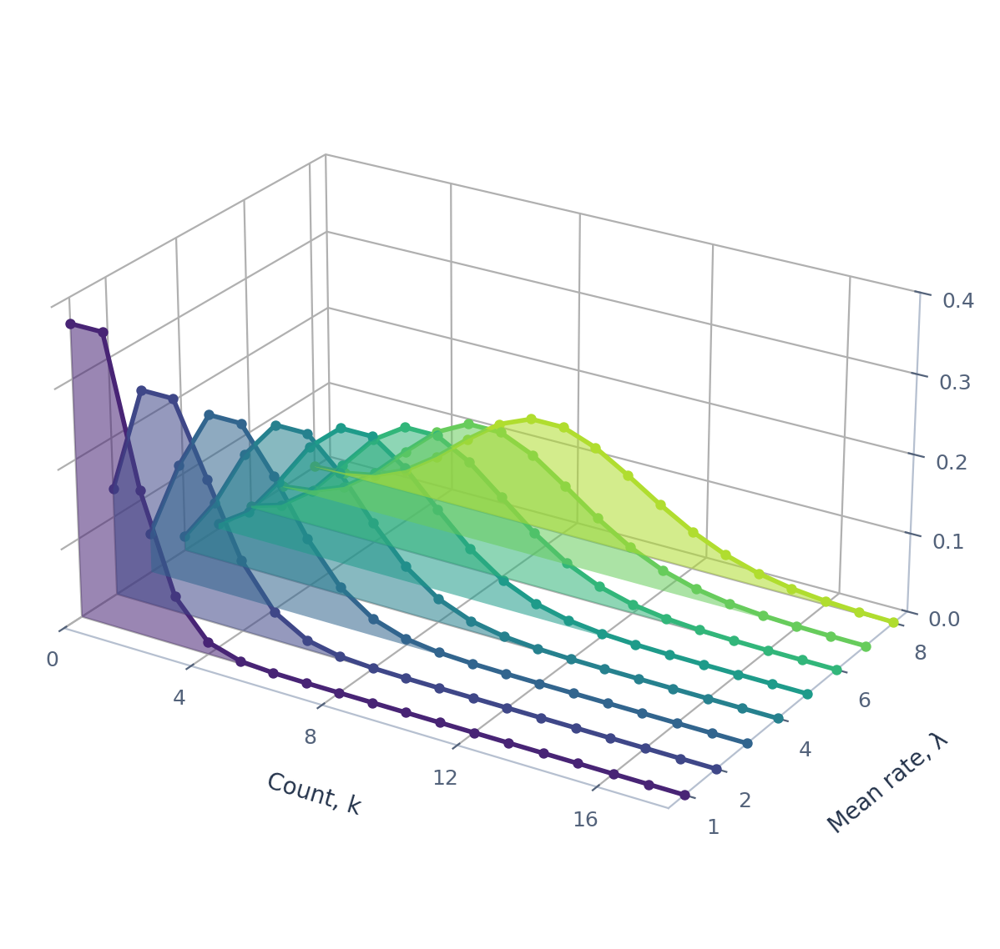
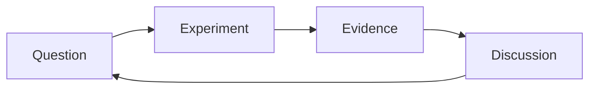

# Presentation mode

Enable a focused reading and presentation layout on selected pages. Normal mode
is the default; the toggle remembers your choice within this documentation site.

For a single page, add YAML front matter:

```yaml
---
template: presentation.html
---
```

For a whole directory, add a `.meta.yml` file containing:

```yaml
template: presentation.html
```

The directory and navigation tab can have any name. There is no required
“Progress” path. The shared configuration enables metadata inheritance.

---

## Presenting an update

Presentation mode enlarges text, hides the site header, tabs, left navigation and
Copy as Markdown button, and keeps the right-hand table of contents on desktop.
The table of contents and section controls appear as floating panels. The sidebar
title changes from “On this page” to “Table of contents” while presenting.

Presentation mode shows only the current section. Long sections scroll naturally;
the arrows switch sections and return to the top. Turning presentation mode off
restores the whole document. TOC links reveal the section containing their heading.

Use top-level Markdown `---` rules to separate sections. Put a heading immediately
after each rule for a named section and anchor navigation. The first heading in a section supplies its
label; a section without headings receives a “Section N” label. Nested rules are ignored.

Use the arrows or Left/Right keys to navigate. **Esc** restores normal mode.
Keyboard shortcuts leave editable controls, dialogs and image lightboxes alone.
Use the browser's fullscreen menu to hide browser controls; this feature does not
request fullscreen itself. Presentation mode is available at desktop widths of 76.25em and above (about
1,220 CSS pixels with the browser's default font size). On narrower viewports,
the toggle and section controls disappear and the normal documentation layout
returns, including Copy as Markdown. Your preference is preserved: widening the
window restores presentation mode if it was enabled. Keyboard shortcuts are
inactive while the viewport is narrow.

---

## Installation and customization

Run `uv run relcon-docs configure` after upgrading relcon-docs. It installs managed
CSS, JavaScript and `presentation.html`, without rewriting existing `mkdocs.yml`.
The default template directory is `docs/overrides`; an existing literal,
project-relative `theme.custom_dir` is respected. Existing files are preserved,
and a conflicting `presentation.html` is reported rather than overwritten.

If your project overrides `extra_css` or `extra_javascript`, include both shared
stylesheets (`relcon-docs.css`, `relcon-docs-presentation.css`) and both shared
scripts (`relcon-docs-math.js`, `relcon-docs-presentation.js`) in those lists.
Keep project-specific styling in separate files, not the managed assets.


---

## Plot example



Click the plot to enlarge it. The lightbox receives Esc before presentation mode.

---

## Diagram example



### Discussion prompts

- What did we learn from the experiment?
- Which assumptions need checking?
- What should we try next?

This subsection has its own TOC link inside the same slide. The rule inside the
following quotation is not a slide boundary:

> A useful result answers a question.
>
> ---
>
> A useful discussion identifies the next question.
